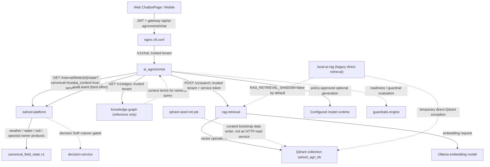

# SAHOOL — RAG / Agricultural Advisor service wiring and truth boundaries

**Source review:** `main@d27cda4f32e183d8e9e17c3774b9b25005cdb310`.
**Supplement:** user-supplied `SAHOOL_Expanded_Architecture_UI_Contracts_20261114` atlas
(base `8a32b01e`, extended `d27cda4f`). The atlas is an **offline static map**, not
runtime proof. The edges below are checked against code, not inferred from images.

## Executable call graph (not a deployment graph)

## Call, trust, and authority matrix

| Caller | Target | Method/path or contract | Trust source | What it proves |
| --- | --- | --- | --- | --- |
| Web | nginx → advisor | POST `/api/ai-agronomist/chat` → `/v1/chat` | Gateway JWT/auth-verified tenant | Code route only; browser E2E separately required |
| Advisor | platform | GET `/internal/fields/{field_id}/state?canonical=true&ai_context=true` | `X-Agent-Token` plus field ownership/RLS; pack tenant matched | Legal `canonical_field_state.v1` and policy pack, not an AI-invented state |
| Advisor | knowledge-graph | GET `/v1/edges` | `X-Tenant-Id` | Retrieval expansion references, **not decision evidence authority** |
| Advisor | rag-retrieval | POST `/v1/search` | `X-Tenant-Id` + `X-Agent-Token` | Tenant-scoped hybrid search; output needs citation/provenance review |
| RAG | Qdrant | Vector/index client | Collection schema, provenance metadata | Index storage; an init job is not a read-through API |
| RAG | Ollama | Embeddings | Profile/model digest, prefix, dimension | Vector-space identity, not general answer correctness |
| local-ai-rag | RAG | Shadow search (flag off by default) | `RAG_RETRIEVAL_SHADOW` | Parity-only observation, not an authority cutover |
| Advisor | generation model | Configured provider; optional | `AI_GENERATION_ENABLED` + tenant policy envelope | Generated text may be suppressed; no physical action authority |
| Advisor | guardrails/approvals | Evaluation and review | Domain/human approval | Proposal is not actuator dispatch |
| Decision owner | Decision SoR | Independent owner migration | Subject-bound DB writer-revocation receipts | Not approved merely because the advisor can explain decisions |

## Operational readiness != RAG authority

`/healthz` only demonstrates HTTP liveness. Advisor `/readyz` requires
RAG/KG/guardrails. Its RAG dependency is now checked with the same
`shared.ai.rag_readiness.rag_operational_ready` predicate used by
`scripts/ci/ai_rag_live_certification.py`:

- HTTP 200 with `status=ready`;
- `embedding_contract_parity=true`;
- `collection_vector_schema_parity=true`;
- `sparse_index_hydrated=true` and a positive integer `sparse_index_count`.

This is **operational** readiness only; it deliberately does not require
`canonical_payload_parity=true`, because that is a separately adjudicated
`rag_authority_convergence.json` cutover gate. A nonempty global index does
**not** prove any given tenant has usable, approved content.

## Deployment readback (14 Nov 2026; not an E2E request)

The inspected Railway project `sahool-staging` deploys `sahool-ai-agronomist`
and `sahool-guardrails-engine`. Its service inventory does not list named
`rag-retrieval`, `knowledge-graph`, `qdrant` or `ollama` services.
The advisor's visible variable **names** do not include `RAG_BASE_URL` or
`KNOWLEDGE_GRAPH_URL`; only names, not secret values, are available via OAuth.
This is `NOT_PRESENT_IN_INSPECTED_PROJECT`, not a claim about external systems.
The advisor deployment healthcheck is `/healthz`, not `/readyz`.
No production/staging variables were changed as part of this review.

## Acceptance evidence — required for service claim

1. Pin exact source SHA, environment/deployment IDs and model/profile digest.
2. Record `rag-retrieval /readyz` fields above, KG /readyz and guardrails.
3. Use a synthetic authorized test tenant; verify missing service token and
   tenant mismatch reject, and that a different tenant never receives another
   tenant's chunks.
4. Five vetted Arabic agronomy questions: cited retrieved chunks with provenance,
   time-validity, permissions and evidence quality; test three deliberately
   unanswered queries that must abstain (especially pesticide or dose requests).
5. Verify advisor `/readyz`, authenticated web/mobile `/v1/chat`, disabled-
   generation semantics and no silent legacy fallback; never perform physical actions.
6. Run `scripts/ci/ai_rag_live_certification.py` from the real service network
   and collect a subject-bound receipt. Live shadow-parity, corpus audit and
   direct-Qdrant revocation remain **separate cutover approvals**.

Do not enable `AI_GENERATION_ENABLED`, promote RAG authority, create new
Ollama/Qdrant services, ingest unverified seed content or change the Railway
healthcheck path solely because this document or its unit tests pass.
