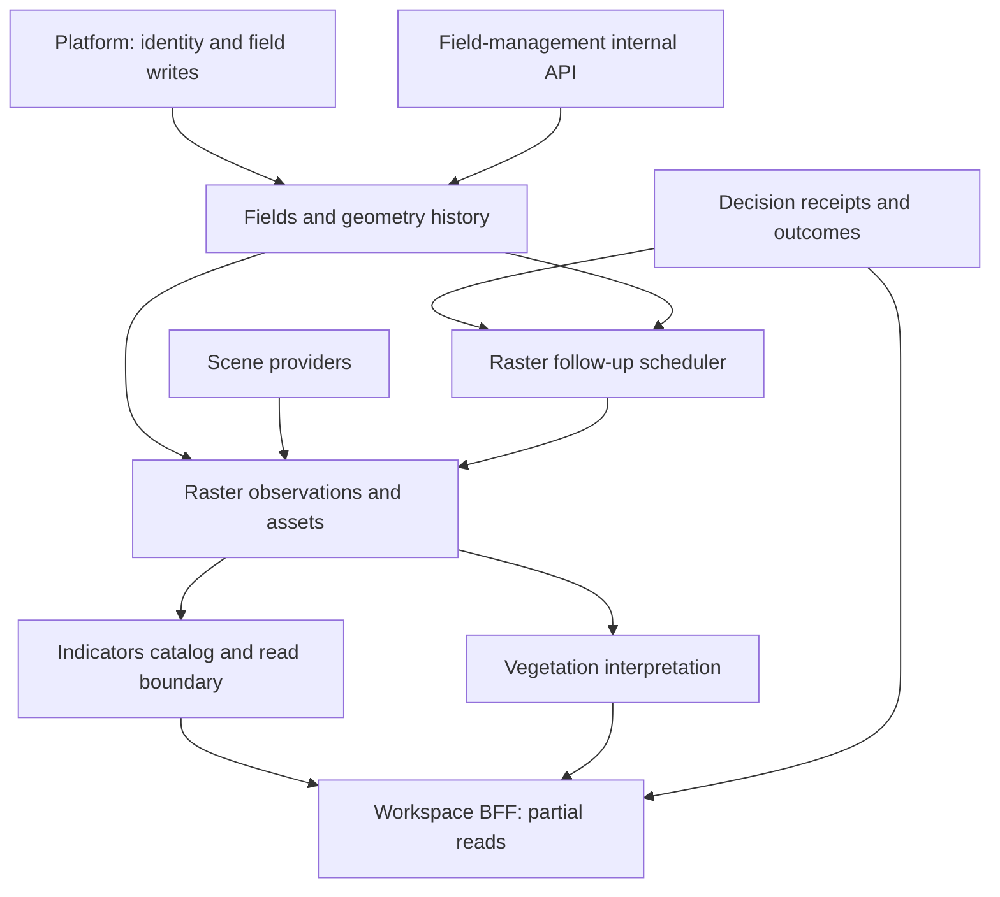

# EO and trial integrity consolidation — 2026-10-29

This review distinguishes restored source, changes reconstructed and tested in the
current workspace, and historical execution claims. It is not a production or
field-validation certificate. The base is
`909b54ec65a9fd0e5644d630f847ca7ce39af45e`.

## Recovery and evidence scope

The durable input is `SAHOOL_Agricultural_EO_Verified_Repairs_20261029.zip`,
SHA-256 `0ef51f62a23efa6ada8269ad73c4ed717c0b54cba0597f68635315ba10ef26e5`.
Its `sahool_from_909b54ec.patch` contains 109 changed files. The archive was
read again, CRC-checked and extracted after rejecting absolute/traversal paths
and symbolic links. This verifies archive integrity, not the behavior of its code.

The interrupted `implementation_20261029` workspace and its latest additional
edits were not recovered from that archive. Earlier test counts and claimed
generator results remain historical evidence until reproduced against the
current source. Do not sum overlapping test suites or describe archived JUnit
reports as a fresh run. The current execution receipts and PR checks must name
the tested revision and report skips and unavailable dependencies separately.

The restored patch includes trial input and geometry integrity, honest undefined
percentage/degenerate statistics, and shared EO quality admission. Newly
reconstructed streaming and runtime configuration work must be assessed against
the final diff and fresh tests; narrative continuity does not establish byte
identity with the interrupted workspace.

## Ownership and consumers from source

There is a source of record per domain, not one universal database sink. A shared
database or content digest does not establish exclusive write ownership.

| Domain / service | Producer or owner | Consumer / path | Source and boundary |
| --- | --- | --- | --- |
| Field identity and geometry | Declared `field-management-service` | Internal `/internal/fields` and `/internal/fields/{field_id}` | [DB ownership](../architecture/db_ownership.yml), [field service](../../services/field-management-service/main.py). Platform still contains direct `INSERT INTO fields` and `UPDATE fields`; ownership cutover is not completed by this patch. |
| Observed spectral products | `raster-service` | Vegetation, platform, indicators gateway | [ownership contract](../../shared/contracts/indicator_ownership.json), [persistence](../../services/raster-service/db_persist.py). Raster still reads `fields` geometry directly. |
| Indicator catalog and aggregation boundary | `indicators-service` | `/v1/indicators/catalog`, observations and timeline | [service](../../services/indicators-service/main.py). Compute endpoint rejects local observed-spectral computation; it does not own a second spectral engine. |
| Vegetation interpretation | `vegetation-analysis-service` | Analysis/anomaly consumers and NATS | [runtime](../../services/vegetation-analysis-service/vegetation_runtime.py), `_publish_analysis`: JetStream acknowledgement is observed, but publication has no durable outbox/retry. |
| Canonical field projection and irrigation recommendation | `sahool-platform` | Frontend and decision-facing read products | [spectral resolver](../../services/sahool-platform/api/canonical_spectral_state.py), [projection](../../services/sahool-platform/api/field_state_projection.py), [irrigation route](../../services/sahool-platform/api/routers/irrigation_recommendation.py). Product authority does not bypass quality or freshness. |
| Remote-sensing workspace | BFF read aggregation | Platform identity check; indicators, vegetation, decision/outcome sections | [BFF](../../services/remote-sensing-workspace-bff/main.py). Concurrent reads can return partial results and do not constitute an atomic cross-service snapshot. |
| Follow-up imagery | Raster request store and scheduler | Accepted execution receipt from decision service, tenant-scoped geometry and imagery jobs | [runtime](../../services/raster-service/follow_up_runtime.py), [store](../../services/raster-service/follow_up_store.py). Receipt, tenant, season, geometry revision and time window remain admission requirements. |

The diagram describes code dependencies, including existing direct database
reads/writes. It does not certify runtime reachability or a completed ownership
migration. There is no implicit arrow from imagery classification to irrigation
actuation.

## Pixel, clipping and tile boundaries

Raster exposes field pixel inspection, field tiles and TileJSON in
[field routes](../../services/raster-service/routers/fields.py); layer tiles are
in [tile routes](../../services/raster-service/routers/tiles.py). The platform
[field facade](../../services/sahool-platform/api/routers/fields.py) is the
browser-facing tenant-verified boundary. COG production and polygon masking
belong to [COG writer](../../services/raster-service/cog_writer.py) and
[tile rendering](../../services/raster-service/tile_render.py).

Windowed writes alone do not make an upstream full-array read bounded. Review
each read separately, including masks, overviews, intermediate copies and DEM
processing. Keep the total-pixel admission limit explicit; a window size is not
permission to process arbitrarily large inputs. Atomic publication must retain
internal masks and preserve the existing output if generation fails. RSS and
throughput improvements need measurements, not inference from function names.

## Scientific and operational limits

- Trial plot digests bind content; they are not signatures or proof of biological
  independence, complete registered layouts, or observation origin. See the
  [trial contract](../../services/sahool-platform/docs/FIELD_TRIAL_REPLICATION_CONTRACT.md).
- A nonzero constant paired difference has no ordinary estimated uncertainty;
  machine-readable review/validity flags must govern interpretation. A zero
  control mean has an undefined relative change, not a zero-percent benefit.
- Scene admission must preserve sensor calibration, scale/offset, bands, grid,
  valid-pixel masks and evidence identity. Legacy provider paths do not become
  admitted simply because another STAC path passes analytic tests.
- MapHub's default remains raw field satellite truecolor. No DeepGlobe weights,
  training pipeline or land-cover-to-irrigation policy is introduced here.
  Model transfer, labels and weight/data licensing still require separate work.
- AGR-01 through AGR-06 are proposed qualification recipes. This consolidation
  does not execute or certify DSSAT, APSIM, WOFOST, Rosetta/EUPTF2 or LAI models.
- Unit, analytic and isolated ASGI checks do not demonstrate live Docker,
  PostGIS, object storage, provider networking, or an end-to-end four-container
  deployment. Live checks must report their actual environment and result.
- No field validation, automatic irrigation permission, main merge or production
  deployment follows from this document. Existing DUP/GAP records retain their
  own closure criteria.

## Independent current-workspace review

The reviewer read the final trial binding, bounded validation response, follow-up
startup checks, Compose environment wiring, strict C1 calibration, COG publication
and polygon masking changes. No new blocking regression was found in this
reviewed scope. This conclusion is narrower than a full repository or security audit.

Fresh independent reruns on 2026-10-29 produced:

| Suite | Result | What was exercised |
| --- | --- | --- |
| `test_cog_windowed_processing.py`, `test_polygon_mask_metadata.py`, `test_stac_c1_processing.py` | 59 passed, 0 skipped | Bounded reads, internal mask preservation under external-mask configuration, atomic failure behavior, spatial metadata and calibrated scene admission |
| `test_imagery_follow_up.py`, `test_trial_spatial_review_guards.py`, `test_trial_review_guards.py` | 76 passed, 0 skipped | Shared JWT policy before database access, restricted role checks, receipt identity, physical plot uniqueness, boolean/overflow rejection and honest numerical contracts |

These suites overlap the implementing agents' suites; do not add them to an
aggregate distinct-test count. The runtime configuration change keeps the worker
disabled for an empty explicit tenant list, retains production RSA policy and
does not remove database role checks. COG/clip changes preserve total-work
admission independently of the window buffer size. Scalar/native upstream reads
and optional DEM processing still include full-grid allocations. No resident
memory bound, resumable chunk execution, provider-live success or container
acceptance was measured by these reruns. Raw logs, JUnit and reviewed-source
digests accompany the delivery evidence outside the source tree.

## Delivery gates

Before a PR is represented as ready, bind its tree to fresh regression receipts,
run the repository preflight protocol, refresh generated files, and correct
manual route anchors where source lines moved. Do not weaken a guard, discard a
large generated audit, or reuse stale generated bytes to work around a transport
limit. Report remote push/PR state from GitHub itself; a prepared local branch
is not a published PR.
