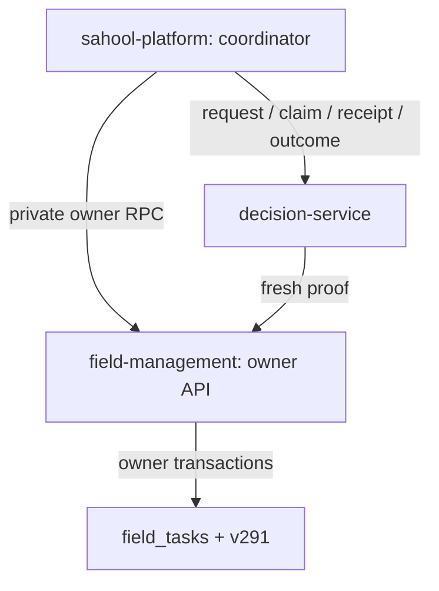

# وصلة تنفيذ تفتيش الحقل

## الحالة والمصدر

هذه متابعة مصدر على `main` عند
`5037c4f9279673c1ebe997cee58c40325f7bee40` بعد دمج #1646. شجرته
`fc4f193ac4d3fbe19fb1ec85732f4d6f8fc59e4d` تطابق شجرة أساس القياس التاريخي
`3c5ed1dc65542c87330ea2f343300bb7683b58e2`. التغيير الموصوف هنا هو رقعة
المتابعة فوق ذلك الأساس، وليس ادعاء أن SHA الأساس غير المعدل يحتويها.

**حالة التصميم الثاني عند هذا التحديث، 2026-11-27: إصلاح مصدر واختبارات محدودة،
ورحلة HTTP فعلية ناجحة ضمن النطاق؛ المتصفح غير مقاس على v2 وpreflight الكامل
لم يُقبل. لا production verified.**
كشف فحص المعمارية دورة حقيقية في التصميم الأول بين decision-service وfield-management:
الأولى تقرأ proof من الثانية، والثانية كانت تنسق التنفيذ باستدعاء الأولى. عولجت
الدورة بنقل التنسيق إلى طبقة BFF القائمة داخل sahool-platform. لم يُخفَ عنوان
خدمة عن الجرد ولم يُخفف حارس الدليل. يسجل القياس المحدود
`task-delivery-v2-platform-gates/summary.json` في 2026-11-27T16:03:51Z صفر
دورات، و622 مسار نطاق ضمن ميزانية 623؛ هذا قياس graph وroute budget فقط،
ولا يحول توقف preflight السابق إلى نجاح.

[الإيصال الدائم](../../certification/evidence/field_inspection_execution_20261127.json)
هو سجل البصمات والطبقات وحدودها. ويحفظ
[Lab PR #182](https://github.com/kafaat/unified-local-lab/pull/182)
الأرشيف وحزمة قبول المتصفح السابقة؛ محتوى النسخة الأولى لا يثبت تشغيل التصميم
الثاني. تبقى إخفاقات المحاولات الأصلية كما وقعت.

## استعادة ميزانية المسارات دون تخفيف الحارس

كشف الفحص المرافق أن الجرد المباشر السابق، 622، لا يتضمن أربع واجهات
`api_route` قائمة. عدّ الملكية الأشمل كان 626 فوق السقف 623؛ لذلك لم يكن نجاح
الجرد المباشر قبولًا لميزانية المنصة. حُفظ الفشل، وبقيت الواجهات الأربع محسوبة.

بعد مراجعة المستدعين والـSDK والاختبارات وسجلات القدرات وبناء العناوين داخل
المستودع، اعتمد منسق المتابعة تقاعد أغلفة توكن الخدمة الثلاثة التالية وحدها:

- `POST /v1/phase10/learning/feature-store/register`.
- `POST /v1/phase10/learning/feature-store/online-materialization`.
- `POST /v1/phase11/federation/runtime/event-envelope`.

تبقى الدوال الصرفة واختباراتها ومسارات cycle القائمة؛ ليست هذه المسارات بدائل
HTTP مكافئة لكل واجهة متقاعدة. لا يثبت البحث داخل المستودع غياب مستهلك خارجي،
ولم تُفحص سجلات وصول الإنتاج. لا تُنسب موافقة بشرية جديدة لهذا القرار.

قبل الحذف فشلت حالتا W4 المقاسوَتان: register أجاب 200 وevent-envelope أجاب 422
بدل 404؛ الثانية تثبت بقاء المسار ولا تثبت قبول جسم الطلب. بعد الحذف نجحت 16 حالة
phase11 API/pure، و24 حالة phase10 محددة تتضمن حالة W4 واحدة متداخلة. تبقى
بوابات W4 الكاملة والملكية/الميزانية والوحدات والقياس الحي على snapshot جديد
قيد التنفيذ عند هذا الإدخال. المستهدف هو 619 مسار نطاق مباشر و623 مع الملكية
الأشمل، مع بقاء السقف 623 والمصنّف والاستثناءات دون تغيير. رحلة HTTP على
`da5ab28b` أعلاه تسبق هذا التقاعد، ولا تُنسب تلقائيًا إلى snapshot لاحق.

## الملكية واتجاه الاتصال

منسق هذه الوصلة في platform يعمل عبر HTTP إلى المالكين ولا يكتب جداولهم.
FM ينفذ أوامر المالك محليًا، وDS يقرأ دليل FM الحالي قبل حفظ النتيجة.

هذا وصف الوصلة وحدها، ولا يعني أن جميع وظائف platform الأخرى بلا SQL أو أن
FM لا يتصل بأي مالك آخر في المنظومة. لا يوجد نداء FM→DS ضمن هذه الوصلة.

| المسؤولية | مصدرها |
| --- | --- |
| المسارات البشرية ومصادقة الجلسة والصلاحيات | [platform inspection_executions router](../../services/sahool-platform/api/routers/inspection_executions.py) |
| التنسيق وعميل DS وعميل FM الخاص | [inspection_execution_adapter.py](../../services/sahool-platform/api/inspection_execution_adapter.py)؛ `ExecutionAdapter` و`HttpDecisionClient` و`HttpOwnerStore` |
| العقود والدوال المشتركة، بلا I/O إلى خدمة أو قاعدة | [shared/field_inspection_execution.py](../../shared/field_inspection_execution.py)؛ `ExecutionBinding` و`binding_from_source` والاشتقاقات الثابتة |
| توافق imports القديمة للـstore | [fm_execution_tasks.py](../../services/field-management-service/fm_execution_tasks.py) يعيد تصدير العقود الصرفة؛ لم يعد منسقًا أو عميل DS |
| RPC المالك وproof المستقل | [fm_execution_routes.py](../../services/field-management-service/fm_execution_routes.py) |
| المهمة والرابط والتأكيد والإقرار وRLS | [fm_execution_task_store.py](../../services/field-management-service/fm_execution_task_store.py) و[v291](../../migrations/v291_field_task_execution_delivery.sql) |
| فحص proof قبل outcome | [field_inspection_evidence.py](../../services/decision-service/field_inspection_evidence.py)، مستدعى داخل [verify_execution_outcome](../../services/decision-service/persistence.py) |

أبقى الفصل بايتات store وv291 كما كانت. تبقى v291 بعد v290 وقبل v240/v206 في
[MANIFEST](../../migrations/MANIFEST.txt)، دون تعديل الهجرات السابقة.

## ربط الطلب بالخطة والمهمة

الوصلة تعمل بطلب المشغّل؛ لا عامل خلفيًا ولا أوامر معدات. يلزم
`target_type=task` و`operation_type=field_inspection`، وقرار وخطة مرتبطان
بالحقل نفسه، وخطة معتمدة تطابق بصمة قيمة القرار الحالية. يقرأ منسق platform
المصدر من DS، ثم يعيد مالك FM حساب binding من `source:{item,lineage,plan}`
عبر العقد المشترك؛ لا يقبل binding جاهزًا يختاره المتصفح.

يحمل `command_payload` الحقل `field_id` وكائن `inspection` الصريح الذي
يطابق `constraints.inspection` في الخطة المعتمدة:

| الحقل | العقد |
| --- | --- |
| `pin_id` | دبوس محفوظ في المستأجر والحقل نفسيهما؛ يطابق `target_id`. |
| `assigned_to` | معرّف حساب نشط ومؤهل للتفتيش في المستأجر. |
| `due_at` | وقت يحمل منطقة زمنية، يُطبّع إلى UTC للمقارنة. |
| `priority` | عدد صحيح من 1 إلى 5. |

لا يُختلق دبوس ولا تُتبنى مهمة يدوية موجودة لنفس الدبوس. يشتق العقد معرّف المهمة
من المستأجر والطلب، وإيصالًا وبصمة ربط ثابتين. يستعمل `ensure_task` قفل الدبوس
نفسه الذي يستعمله [التفتيش اليدوي](../../services/field-management-service/fm_task_inspection.py).
تعيد المحاولة المطابقة المهمة والرابط نفسيهما؛ يُرفض طلب آخر للدبوس أو ربط مخالف.

## واجهات المستخدم الحالية

تدخل المسارات الثلاثة الجديدة إلى platform عبر البوابة العامة. المصدر هو router
المنصة أعلاه و[عميل الواجهة](../../frontend/src/services/api/inspectionExecutions.ts).

| العملية | المسار الكامل | الصلاحية |
| --- | --- | --- |
| العرض | `GET /api/v1/inspection-executions/fields/{field_id}` | `FIELD_VIEW` وحقل مملوك للسياق؛ limit من 1 إلى 100. |
| الاستلام | `POST /api/v1/inspection-executions/fields/{field_id}/requests/{execution_request_id}/receive` | owner/manager مع `FIELD_EDIT` وحد تنفيذ القرار. |
| تأكيد النتيجة | `POST /api/v1/inspection-executions/fields/{field_id}/tasks/{task_id}/verify` | آخر مراجع معتمد، owner/manager، مع `INSPECTION_REVIEW` وحد تنفيذ القرار. |

جسم POST هو JSON `{}` مطلوب؛ تُرفض الحقول الإضافية. لا يرسل المتصفح tenant أو
actor أو تكليفًا بديلًا أو `actual/metrics` أو proof. مسارات التنسيق البشرية
الثلاثة القديمة في FM أزيلت. تبقى مسارات قبول التكليف وfinding والمراجعة القائمة
تحت `/api/v1/field-tasks/` بعقدها الأصلي؛ لا تتحول إلى RPC المالك الجديد.

بين الاستلام والتأكيد يقبل المفتش التكليف، ويقدم finding وإصدار evidence،
ويعتمده مراجع مستقل، ثم تُغلق المهمة. صلاحية مراجعة agronomist وحدها لا تمنحه
صلاحية تأكيد التنفيذ؛ يجب أن يكون المعتمد الأخير صاحب دور owner/manager.

## قناة المالك الخاصة

ينادي platform فقط:

`POST /internal/field-inspection-execution-owner/{operation}`

العملية Literal من القائمة المغلقة التالية، والجسم مضبوط بـ`extra=forbid`.
لا يوجد dispatch حر باسم دالة أو SQL يرسله العميل.

| العملية | حقول الجسم |
| --- | --- |
| `require-field` | `field_id` |
| `get-link` | `execution_request_id` |
| `list-links` | `field_id, limit` |
| `validate-binding` | `field_id, execution_request_id, source:{item,lineage,plan}` |
| `ensure-task` | الحقول السابقة مع `claim:{authoritative,persisted,execution_request_id,adapter_id,adapter_kind,delivery_state}` |
| `readback` | `field_id, execution_request_id`؛ يقرأ FM الرابط ويبني binding محليًا. |
| `preview-confirmation` | `execution_request_id`؛ يستخرج FM الرابط بدل قبول link من العميل. |
| `prepare-confirmation` | `field_id, task_id`؛ الدليل الفعلي من مالكه. |
| `save-outcome` | `execution_request_id, confirmation_id, result`؛ لا proof حر. |

الغلاف الموثق للرد هو
`{schema:"sahool.field-inspection-owner/v1",authoritative:true,tenant_id,operation,data}`.
يتحقق عميل platform من الغلاف ونوع البيانات وهوية الطلب والمستأجر، ويفشل عند
تعذر المالك أو اختلاف الرد؛ لا نجاح بديل من بيانات مخزنة لدى المنسق.

تحمل القناة `X-Field-Inspection-Coordinator-Token` و
`X-Service-Name=sahool-platform`، ومعهما `X-Tenant-Id/X-User-Id/X-User-Role`
مشتقة من جلسة المستخدم المتحقق منها في BFF. لا تُنسخ ترويسات هوية يختارها
المتصفح. يرفض FM وجود `X-Field-Tasks-Token` على هذه القناة، ويتحقق من الاعتماد
والدور. يعيد store فحص الحساب النشط ودوره داخل المستأجر في كل عملية بشرية،
وتضبط [caller_connection](../../services/field-management-service/fm_gateway.py)
سياق tenant/user/role محليًا داخل المعاملة؛ لا تجاوز لـFORCE RLS.

## ترتيب الالتزام والتأكيد

1. يقرأ platform رابطًا سابقًا أو request/lineage/plan من DS، ثم يطلب تحقق FM
   من الحقل والدبوس والمستلم **قبل claim**.
2. يحجز الطلب لدى DS. يحمل ensure-task إلى FM إسقاط claim ذي الحقول الستة،
   دون delivery token الخام. يحفظ FM المهمة والرابط في معاملة واحدة.
3. بعد انتهاء الطلب السابق، ينفذ platform طلب HTTP مستقلًا لـreadback من FM.
   بعدها فقط يرسل receipt إلى DS ويطابق رده قبل إرجاع `accepted`.
4. عند تأكيد النتيجة، يحفظ FM confirmation الحالية ويغلق معاملتها قبل أي نداء
   DS. يرسل platform إلى DS payload مشتقة من proof المالك.
5. داخل verifier العام، يقرأ DS proof الحالية من FM اعتمادًا على قناته المستقلة،
   ثم يطابق سلسلة الطلب والمهمة والخطة والإذن والحقل والدبوس والمراجع ونسخة
   الدليل والصورة وبصماتهما و`actual/metrics` ومفتاح التماثل قبل حفظ outcome.
6. بعد رد DS المطابق، يسجل platform إقرارًا تاريخيًا لدى FM. يستخرج FM task/field
   من الرابط المحفوظ، وتثبت v291 ارتباط confirmation والرد. تعاد `verified_success`
   للواجهة بعد إقرار المالك المطابق.

مسار DS المستقل يبقى:

`GET /internal/field-tasks/execution-proofs/{execution_request_id}`

باعتماد `X-Field-Inspection-Proof-Token` و`X-Tenant-Id`. يرفض جمهور gateway
البشري ويقرأ صفوف المالك فقط. الحارس داخل `verify_execution_outcome` ملزم
حتى عند الطلب المباشر من BFF أو عميل آخر؛ status 200 أو `current=true` وحدهما
لا يثبتان صحة الدليل.

## السجلات والحالات

الجداول الجديدة مملوكة لـfield-management. مراجع القرار والخطة والإذن مراجع
نوعية محفوظة، بلا مفاتيح أجنبية إلى جداول خدمة القرار.

| السجل | ما يثبته |
| --- | --- |
| `field_task_execution_links` | ربط ثابت للمستأجر والطلب والمهمة والحقل والدبوس والخطة والإذن والترابط والمستلم والموعد والأولوية وبصمة الطلب؛ uniqueness داخل المستأجر. |
| `field_task_execution_confirmations` | لقطة مؤرخة لاعتماد مستقل لأحدث نسخة تفتيش، مع الصورة وبصمتها إن وجدت، والمفتش والمراجع و`actual/metrics`. يمكن إلحاق لقطة أحدث قبل حفظ إيصال نتيجة نهائي. |
| `field_task_execution_outcome_receipts` | إقرار مطابق لنتيجة DS المحفوظة، مرتبط بتأكيد بعينه؛ confirmation وحدها لا تثبته. |

تفرض v291 ENABLE/FORCE RLS ومفاتيح مركبة وحراسًا تمنع خلط المستأجر أو الحقل
أو المهمة أو الدبوس. السجلات append-only، وTRUNCATE مرفوض أيضًا. يبقى قياس
العزل بدور NOBYPASSRLS في جناح PG منفصلًا عن اختبارات نقل HTTP.

`delivering` حجز لدى DS، و`accepted` قبول تسليم مهمة بعد readback وإيصال DS،
أما `verified_success` فيستلزم outcome والدليل والإقرار المطابقين. لا تكفي
`completed` وحدها: يلزم آخر approve، وآخر submit بعد آخر reopen، وأحدث نسخة
وصورة، ومراجع مختلف عن المفتش ومسجل النسخة. لا تُختلق صورة عند غيابها؛ يلزم
تطابق الغياب أيضًا. تبقى قواعد [v274](../../migrations/v274_inspection_evidence_versions.sql)،
[v275](../../migrations/v275_inspection_handoffs.sql) و
[v277](../../migrations/v277_inspection_close_gate.sql) كما هي.

مفتاح النتيجة هو `inspect-outcome-` مع SHA256 كاملة: طوله 80، مطابق لحد
`outcome_record.idempotency_key`. الإخفاق الحقيقي السابق للبادئة ذات طول 83
محفوظ؛ لا تُعدّل confirmation تاريخية لتغيير مفتاحها.

## الإعداد وملكية الأسرار

الراية مطفأة افتراضيًا؛ تطبيق الهجرة لا يفعّلها. المصدر
[.env.example](../../.env.example) و[Compose](../../docker-compose.v9.yml).

| الإعداد | المستهلكون في هذه الوصلة والغرض |
| --- | --- |
| `FIELD_INSPECTION_EXECUTION_ENABLED=0` | platform وFM؛ بوابة المنسق وعمليات المالك وproof. |
| `FIELD_INSPECTION_EXECUTION_ADAPTER_ID` | platform وFM بالقيمة نفسها؛ الافتراضي `field-management-service-inspection-v1`. |
| `FIELD_INSPECTION_DELIVERY_TOKEN_KEY` | platform فقط؛ مفتاح ثابت لا يقل عن 32 بايت لاشتقاق HMAC من tenant/request/adapter. لا يدخل قناة FM ولا يُعاد للمتصفح أو يُحفظ خامًا. |
| `FIELD_INSPECTION_COORDINATOR_TOKEN` | platform وFM فقط؛ قناة RPC المالك، مستقلة عن proof وعن gateway. |
| `FIELD_INSPECTION_PROOF_TOKEN` | DS وFM فقط؛ قراءة proof المستقلة، ولا يمنح حق أوامر المالك. |
| `FIELD_MANAGEMENT_SERVICE_URL` | platform لعمليات المالك، وDS لقراءة proof. |
| `DECISION_SERVICE_URL / DECISION_SERVICE_TOKEN` | platform لنداء DS؛ لا يحتاجهما FM لهذه الوصلة. يظل اعتماد DS نفسه مضبوطًا لديها. |
| `FIELD_TASKS_SERVICE_TOKEN` | nginx وFM لمسارات التفتيش/المهام القائمة؛ لا يجيز coordinator RPC أو proof. |

تبقى قيمة adapter ومفتاح HMAC ثابتين لاسترداد الطلبات المحجوزة بهما؛ تغييرهما
ليس استردادًا تلقائيًا. نقل موقع المنسق لا يغيّر provider
`field-management-service` في receipt، لأنه يصف مالك المهمة. إطفاء الراية لا
يلغي حارس DS ولا يعيد صلاحية اعتبار accepted نجاحًا.

## الاسترداد وحدوده

- **ضياع الرد بعد إنشاء المهمة:** إعادة الطلب تقرأ الرابط المحفوظ وتتحقق من المهمة
  بعد commit، ثم تعيد receipt الأصلية، دون مهمة ثانية.
- **تقادم الدليل قبل outcome:** يُرفض التأكيد القديم؛ بعد submit واعتماد جديدين
  يمكن إلحاق confirmation أحدث ما دام إيصال نهائي لم يُحفظ محليًا.
- **وصول رد DS ثم تغير الصورة أو reopen قبل ack:** الإقرار سجل تاريخي لنتيجة
  حُفظت بالفعل. لا يعيد FM فحص current proof في save-outcome؛ يطابق الرد مع
  confirmation التاريخية وسلسلة الرابط، ولا يستبدلها بدليل جديد.
- **إعادة فتح المهمة بعد النتيجة:** يبقى الإقرار السابق تاريخيًا ولا يُنسب إلى
  الدليل الجديد.
- **حد غير محلول بالكامل:** إذا حفظ DS النتيجة وضاع رد HTTP ثم تقادم الدليل
  قبل retry، يرفض حارس DS إعادة النتيجة بناءً على proof لم تعد حالية. قد تبقى
  الحالة المحلية accepted رغم وجود outcome بعيد؛ لا مصالحة شاملة لهذه الحالة.

`observed_at` وقت القراءة وconfirmation لقطة مؤرخة. لا تجميد للصورة أو reopen
ولا معاملة موزعة تضمن ثبات الدليل حتى commit الآخر. نجاح تفتيش مسجل ليس قياس
ري أو تشغيل عتاد.

## سجل القياس ومحاولات القبول

تحفظ الأدلة بصمة كل طبقة؛ لا تجمع الأعداد المتداخلة ولا تنقل حكمها إلى مصدر
أحدث بلا شاهد. سجلات التصميم الثاني تشمل 58 وحدة للمنسق، و129 عقد ASGI للمالك،
و88 لمسارات platform، و98 لعقد عميل المالك عبر MockTransport. هذه طبقات ببدائل
معلنة، لا دليل خدمات حية أو DB. يحفظ سجل عميل المالك محاولته الأولى ذات الفشلين
ومعالجة تحقق tenant في الإقرار وتصحيح fixture، ثم نجاح 98، دون إعادة تسمية
المحاولة الأولى. دليل حارس DS ذي 116 حالة مستقل عنها.

أعادت مجموعة الوحدات المجمّعة تشغيل هذه الطبقات نفسها مع حارس DS: سجل
`task-delivery-v2-combined-unit.xml` عند 2026-11-27T16:11:12Z يثبت
489/489 نجاحًا، بلا فشل أو تخطٍّ. هذا تشغيل واحد للوحدات المذكورة؛ لا يضاف
إلى أعدادها السابقة، ولا يثبت PG أو خدمات حية أو متصفحًا.

نجحت سابقًا 42 حالة PG17.12/PostGIS3.5.2 على store/v291 نفسيهما، ثم إعادة
محددة لحالة اسم المستلم وحالة طول المفتاح؛ الإعادتان لا تزيدان كتالوج 42.
إعادة v291 وحدها أبقت المخطط مطابقًا. فحص absent/blank GUC يخص الجداول الثلاثة
الجديدة، ولا يغير حكم إخفاق سابق على جداول أخرى. محاولة PG المتوقفة
21 PASS/1 FAIL بسبب مقارنة `pg_trigger.tgenabled` البايتية بنص محفوظة قبل
تصويب الاستعلام وإعادة القياس.

رحلة HTTP المحلية الناجحة السابقة تخص التصميم الأول: التحضير 19 تحققًا عبر 8
طلبات، والإكمال 59 نجاحًا و3 غير مقاسة من 62 تحققًا عبر 32 طلبًا. الطلبات والتحققات
متداخلة. لا تثبت هذه الرحلة runtime v2 بعد نقل المنسق.

رحلة v2 الفعلية في `task-delivery-runtime-v2-pgqrtogz` قاست overlay
`da5ab28b960cbae93b565e6b951f238a5b3c66f1` فوق main `5037c4f9`، مع تطابق
بصمات المصدر قبلها وبعدها. التحضير: 8 طلبات HTTP و19 تحققًا ناجحًا. الإكمال:
34 طلبًا و64 تحققًا دلاليًا، منها 63 PASS وصفر FAIL وحالة صورة متقادمة واحدة
NOT_MEASURED دون scout/S3. هذه أبعاد متداخلة لا تُجمع. شمل القياس نسخة platform
مطفأة الراية ونسخة DS بلا إعداد proof، والمستأجر الآخر والتجاوز قبل الدليل
وإعادة النتيجة؛ استُخدمت خدمات المصدر وnginx وPG17.12/PostGIS3.5.2، بلا متصفح.
لقطات القاعدة إدارية للصفوف الاصطناعية في 14 جدولًا؛ ليست اعتماد RLS شاملًا.
يحفظ [الإيصال](../../certification/evidence/field_inspection_execution_20261127.json)
البصمات ومراجعة مستقلة للأدلة؛ يبقى الحكم العام INCONCLUSIVE.

| محاولة Lab #182 | النتيجة المحفوظة |
| --- | --- |
| [46027367425](https://github.com/kafaat/unified-local-lab/actions/runs/46027367425)، الرأس `2d38ca85` | failure قبل إنشاء أي job بسبب استعمال `runner.temp` داخل jobs.env في موضع غير مسموح؛ نُقلت التهيئة إلى خطوة GITHUB_ENV. لم يبدأ المتصفح. |
| [46027907708](https://github.com/kafaat/unified-local-lab/actions/runs/46027907708)، الرأس `8ee53d04` | وصل إلى native PG16/build، ثم رفض launcher متغيرَي التقاط nginx المشروعين `${pre}/${post}` عند إعداد البوابة. صفر مراحل HTTP وصفر حالات متصفح؛ يبقى FAIL_BEFORE_BROWSER. |
| [46028005665](https://github.com/kafaat/unified-local-lab/actions/runs/46028005665) | نجاح جودة workflow بواسطة actionlint 1.7.12 وzizmor 1.31.1 على merge `eb08b3d4`؛ هذا فحص YAML/workflow، لا تنفيذ متصفح. |

توقف preflight المحلي الأول بسبب admission يدوي، ثم توقف الثاني عند SCC
الحقيقية؛ الأجنحة لم تبدأ فيهما. معالجة الدورة ونجاح graph المحدود لا يثبتان
نجاح preflight كامل. نجحت رحلة HTTP المحددة أعلاه؛ المتصفح على v2 ما زال غير مقاس.
الصورة المتقادمة عبر HTTP غير مقاسة دون scout/S3؛ شواهد PG منفصلة.

## التشغيل المحدود والتراجع

مصادر الاختبارات الحالية هي
[وحدة المنسق](../../services/field-management-service/tests/test_execution_tasks_unit.py)،
[عقد عميل المالك](../../services/sahool-platform/tests/test_inspection_execution_owner_client.py)،
[مسارات platform](../../services/sahool-platform/tests/test_inspection_execution_routes.py)،
[مسارات FM الخاصة](../../services/field-management-service/tests/test_execution_routes_unit.py)،
[حارس DS](../../services/decision-service/tests/test_field_inspection_outcome_owner_gate.py)
و[PG الفعلي](../../tests_v9/test_field_task_execution_delivery_live_pg.py).
تسجيلها في CI وإيصال runtime/browser لهما تحقق مستقل؛ هذا تحديث وثائق لا تشغيلًا جديدًا.

يتطلب PG قاعدة محلية معزولة ومهاجرة مسبقًا و`TEST_DATABASE_ADMIN_URL`، مع
`FIELD_TASK_EXECUTION_CERTIFICATION_REQUIRED=1` لمنع التخطي الصامت. ينشئ
أدوارًا مؤقتة وfixtures صناعية ويزيل الأدوار وصلاحياتها؛ يزيل المشغّل القاعدة
المملوكة بعد حفظ الأدلة.

لإيقاف الوصلة، أطفئ رايتها في platform وFM وأبق حارس DS والجداول والإيصالات
محفوظة. لا تحذف السجلات بهجرة عكسية ولا تعدل هجرة مطبقة. نشر الخدمة وتفعيلها
وقبول المتصفح أحكام مستقلة؛ لا أمر actuator ضمن هذه المتابعة.
