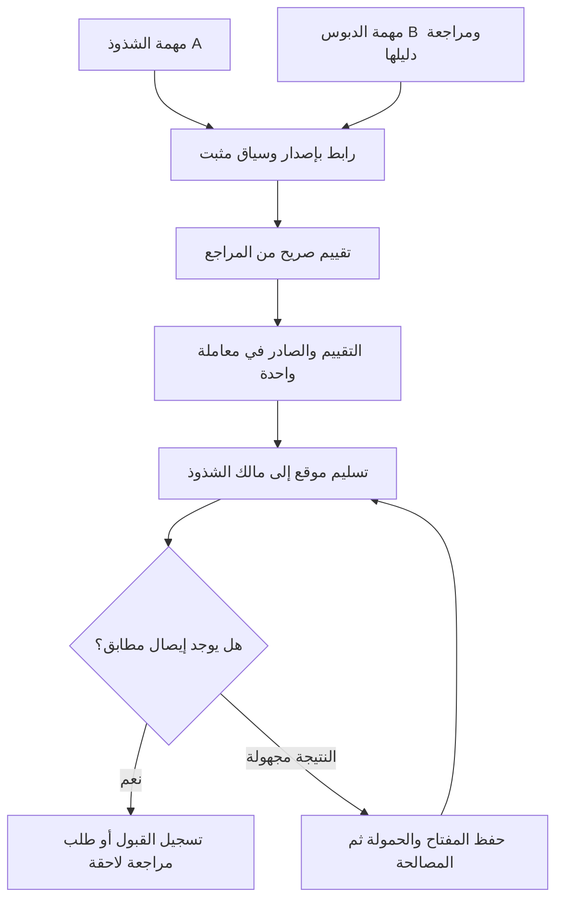

# جسر المعاينة الموثقة: مرشح تنفيذ محلي

**التاريخ:** 24 نوفمبر 2026. **الأساس:** `d7bffb68958a740d72f071b97c206c22c98b8bd7`.
**الحالة:** شيفرة مرشحة واختبارات محلية؛ الرايتان مطفأتان افتراضيًا. هذه الوثيقة لا تمنح إذن نشر أو ترحيل بيئة، ولا تصف منتج المعاينة كاملًا بأنه مُعتمد ميدانيًا.

## 1. ما تعالجه الشريحة

كان مسار الشذوذ ينشئ مهمة A تحمل `anomaly_ref` ولا تحمل دبوسًا. أما صور المعاينة ومراجعتها فتخص مهمة B المرتبطة بدبوس. تمنع v277 وv282 تحويل A إلى B، وتمنع v274 إلحاق نسخة دليل دبوس بمهمة بلا دبوس. يحفظ الجسر المهمتين ويضيف علاقة ذات مراجعات، وتقييمًا بشريًا صريحًا، وصندوق تسليم دائمًا لدى field-management-service. مصدر العائق السابق: [سجل الفجوات](../../sahool-brain/gaps/registry.md)، `VEGETATION-VERIFICATION-RESULTS-CALLBACK-NO-SENDER-01`.

اعتماد صورة B أو إكمال A لا ينشئ نتيجة تحقق. يسجل صاحب المراجعة الحالية تقييمًا إضافيًا يذكر السؤال والمشاهدات والتغطية وحدود الحكم. النتيجة `confirmed/rejected/inconclusive` تصف الإشارة المرصودة ضمن تلك التغطية. الحقول `causal_diagnosis` و`execution_verified` و`training_label_approved` تبقى منفصلة ولا تُستنتج من هذا الإجراء.

## 2. المالك والملفات

| الجزء | الموضع | المسؤولية |
|---|---|---|
| واجهات المالك | `services/field-management-service/fm_verification.py` | السياق، الربط، التقييم، الاستعلام عن الصادر، التسليم والمصالحة |
| عقود الطلب | `fm_verification_contracts.py` | الحقول الصريحة والأنواع والبصمات وحدود التغطية |
| القراءة والكتابة | `fm_verification_store.py` | النطاق من المالك، مراجعات الرابط، أهلية المراجع، معاملة التقييم والصادر |
| موصل S2S | `fm_verification_client.py` | عنوان من إعداد الخدمة، توقيع الطريقة والمسار والمستأجر والطلب |
| المستقبل | `services/vegetation-analysis-service/routers/verification.py` | لقطة المالك، CAS، قبول النتيجة وإيصالها في انتقال واحد |
| تطبيع التسليم | `shared/contracts/remote_sensing/verification_delivery.py` | حمولة الحقول السبعة وبصمتها وربط مفتاح الإعادة بالطلب الموقع |
| التخزين | `migrations/v289_scouting_verification_bridge.sql` | أربعة جداول يكتبها field-management فقط، مع FORCE RLS وحراس النسخ |

الجداول: `scouting_verification_links`، `scouting_verification_versions`، `scouting_verification_assessments`، `scouting_verification_outbox`. السجلات التاريخية ثابتة؛ تصحيح الرابط ينشئ مراجعة أخرى. لا يُستبدل الكاتب الحالي للحقول أو المنح أو صور المعاينة أو المواسم أو الشذوذ. توثيق القراءات الجديدة في [db_ownership.yml](../architecture/db_ownership.yml) لا يضيف صلاحية SQL لكتابة منح المزارع.

رقم v289 مرشح مبني على الرأس المحدد. يُعاد فحص الترقيم عند الدمج وفق قائمة الترحيلات حينئذ. موضعه في [MANIFEST.txt](../../migrations/MANIFEST.txt) قبل v240 وv206، مع تضمينه في المشغل القديم. لا يفعّل تطبيق SQL الرايتين. ملف الرجوع يرفض حذف السجلات إذا كان الرابط أو الصادر غير فارغ؛ لم يُنفذ الرجوع في هذه الجولة.

## 3. رحلة الاستخدام البرمجية

1. تنشئ القناة القائمة مهمة الشذوذ A. تُنشأ مهمة الدبوس B وتُسند عبر مسار المعاينة القائم.
2. يطلب المراجع السياق بتمرير B ونوع ربط الموسم. يحل الخادم الحقل والمزرعة والموسم والحدود من السجلات المالكة، ويقرأ لقطة الشذوذ من مالكها.
3. يرسل أمر الربط بمعرف ثابت، ومراجعة متوقعة، وبصمة السياق الذي راجعه. تغير السياق يحجب الربط. إعادة الأمر نفسه تستعيد إيصال مراجعته؛ لا تنشئ اعتمادًا أحدث.
4. يقبل المفتش B، ويرفع نسختها، ويراجعها شخص مخول آخر عبر الواجهات القائمة.
5. يقدم صاحب الموافقة الحالية تقييمًا صريحًا على مراجعة B ونسخة دليلها. تُحفظ نسخة التقييم وطلب التسليم في معاملة واحدة.
6. يستدعي المراجع تسليم سجل الصادر. يقرأ المرسل إيصال المالك أولًا، ثم يعيد فحص الأهلية قبل POST. تستعيد إعادة المحاولة المفتاح والحمولة نفسيهما.

هذه الشريحة تتيح التسليم الصريح لكل سجل عبر API. لا تضيف عاملًا خلفيًا عامًا أو زرًا جديدًا في الواجهة. يمكن للواجهة لاحقًا عرض حالة المالك واستدعاء المسار نفسه بدل إنشاء كاتب آخر.

### مسارات field-management

البادئة الداخلية `/internal/field-tasks`؛ بوابة المسار القائمة `/api/v1/field-tasks` تتولى قناة المستخدم. نجاح الاختبارات المحلية لا يثبت نشر تلك البوابة.

| الطريقة | اللاحقة | الوظيفة |
|---|---|---|
| GET | `/fields/{field_id}/tasks/{task_id}/verification-context` | سياق الرابط؛ query: `inspection_task_id`, `season_binding` |
| POST | `/fields/{field_id}/tasks/{task_id}/verification-links` | أمر ربط أو مراجعة جديدة |
| POST | `/fields/{field_id}/verification-links/{link_id}/assessments` | التقييم والصادر الذريان |
| GET | `/fields/{field_id}/verification-assessments/{assessment_id}` | سجل التقييم الأصلي وبصمته ومرجع دليله |
| GET | `/fields/{field_id}/verification-deliveries/{delivery_id}` | حالة الصادر وعدد المحاولات وآخر سبب |
| POST | `/fields/{field_id}/verification-deliveries/{delivery_id}/deliver` | إرسال أو مصالحة صريحة |

يستخدم المستقبل مسارين منفصلين تحت `/internal/anomalies/{anomaly_ref}/`: `verification-context` و`verification-results`. يبقى مسار JWT القديم كما هو. لا يمرر المرسل JWT المستخدم إلى المستقبل.

## 4. نطاق النسخة الأولى

- تحقق هوية المستأجر والحقل والمهمة والموسم بين A وسجل الشذوذ، ثم B ودبوسها وصورتها وسجل موسمها المقبول.
- `accepted_record` يطابق معرف سجل الموسم المقبول نفسه. `canonical_season` يتطلب علاقة v207 نشطة صريحة وحيدة إلى ذلك السجل؛ لا تُستنتج من التاريخ أو اسم المحصول.
- تقرأ حدود الحقل وإصدارها من `fields`. يتحقق PostGIS من وقوع نقطة المعاينة داخلها. تدخل الهندسة وبصمتها والإصدار وموضع الدبوس في السياق المحفوظ.
- المنتج الحالي لإشارة الحقل يحمل `geometry_ref=None`. أي مرجع قطاع غير محلول يُرفض بـ`subfield_geometry_resolver_required`؛ لا يستبدله الجسر بالحقل كله.
- لا يثبت وقوع الدبوس داخل الحقل تمثيل الزيارة لكل مساحته. `coverage=inspection_site_only` يسمح بـ`inconclusive` فقط. التأكيد أو الرفض يتطلب `anomaly_target_reviewed` مع أساس تغطية ومشاهدات وحدود مكتوبة يقرها المراجع.
- `manual-signal-field-check/v1` عقد مراجعة بشرية لهذه الشريحة، وليس بروتوكول تشخيص زراعي معايرًا. لا تقاس سلامة ما كتبه المراجع علميًا بمجرد استيفاء حقول JSON.

بصمة لقطة الشذوذ تحفظ سجل المالك الذي جرى الربط عليه. ليست إعادة تشغيل تاريخية لكل مشاهد EO وأزمنة الإتاحة؛ هذه أهلية المنتج الرصدي لدى مالكه. لا يزعم هذا الجسر إغلاق ملاحظات v8 الزمنية أو معالجة ملفات EO.

## 5. التفويض والتسليم

تستخدم الواجهات صلاحية `inspection:review` القائمة، وتعيد فحص المستخدم الفعلي ونشاطه ودوره. يحتاج غير المالك إلى منحة مزرعة نشطة. القراءة من `farm_access_grants` عادية؛ `FOR SHARE` يحتاج UPDATE على PostgreSQL فلا يستعمله هذا المسار ولا يمنح الكتابة كي يحصل عليه. لا تُفعّل `SAHOOL_FARM_SCOPE_ENFORCE` عالميًا.

التقييم والتسليم يتطلبان صاحب الموافقة الحالية نفسه، مع منع المراجع من تقييم عمل أُسند إليه. إعادة الإسناد أو تغير الدليل أو إلغاء A/B تحجب الإرسال الجديد. تظل المقارنة بين الإصدارات داخل معاملات المالك؛ لا توجد معاملة موزعة تشمل الخدمة الأخرى. إذا قُبلت النتيجة ثم اكتُشف تغير المصدر، تحفظ حقيقة القبول وتصبح الحالة `delivered_review_required`.

يتضمن التسليم السبعة حقول التي يقبلها `VerificationCompletion` الحالي. تشير `task_ref` إلى A، ويشير دليل التقييم إلى السجل الذي يربطها بمراجعة B. تربط البصمة بالوقت الثابت ومراجع الأدلة والنتيجة والإصدار المتوقع. يحمل التوقيع هوية الخدمة والمستأجر والطريقة والمسار المشفر ومعرف طلب مرتبط بمفتاح الإعادة وبصمة الجسم.

يكتب مالك الشذوذ النتيجة والإيصال معًا في انتقال CAS قائم. الإيصال يحفظ الطلب الأصلي وبصمته وبصمة اللقطة ونسختي ما قبل القبول وبعده. عند نسخة القبول تُطابق حقول النتيجة الفعلية؛ وبعد انتقال مشروع لاحق يستعاد الإيصال التاريخي دون فرض أن أسباب الحالة الجديدة مساوية لأسباب التحقق القديم.

| حالة الصادر | معناها |
|---|---|
| `pending` | التقييم والصادر محفوظان؛ لم يبدأ التسليم |
| `sending` | محاولة تحمل حجزًا محدودًا؛ لا تثبت قبول المستقبل |
| `delivery_unknown` | تعذر إثبات النتيجة؛ يُحتفظ بالمفتاح والجسم للمصالحة |
| `blocked` | تغير نطاق/مراجعة أو تعارض يحجب التسليم الجديد |
| `delivered` | إيصال المالك مطابق وإعادة التأهيل المحلية ناجحة |
| `delivered_review_required` | القبول ثابت لكن تغيرًا محليًا يستدعي المراجعة |
| `delivery_exhausted` | بلغت المحاولات حدّها (8) دون إثبات؛ قد يكون المالك قبل محاولة سابقة أو لم يقبل، فتُسلَّم لشخص ولا يُعاد الإرسال تلقائيًا |

تفرض v289 آلة الحالات نفسها في SQL (`scouting_verification_delivery_guard`): الانتقالات المسموحة وحدها، والحالات النهائية مجمدة، ولا `delivered` بلا إيصال، والحجز موجود عند `sending` وحدها، ومحاولة واحدة لكل حجز، ولا حجز بعد الحد. لا مسار لإعادة `blocked` إلى `pending` في هذا الإصدار.

حجز الإرسال لا يضمن تنفيذًا ماديًا مرة واحدة ولا ينسق آلة زراعية. لا تعد الحالة `sending` إقرارًا بالاستلام. عند مهلة HTTP لا يزيد `expected_version` ولا يولد مفتاح عملية جديد.

## 6. الإعدادات

| الخدمة | الإعداد | الافتراض |
|---|---|---|
| field-management | `FM_SCOUTING_VERIFICATION_ENABLED` | `0` |
| vegetation-analysis | `VEGETATION_VERIFICATION_BRIDGE_ENABLED` | `0` |
| field-management | `VEGETATION_VERIFICATION_URL` | عنوان vegetation الداخلي في قالب Compose |
| الطرفان | `VEGETATION_VERIFICATION_SERVICE_TOKEN` | فارغ؛ الرفض عند غياب الإعداد. رمز مخصص للجسر: لا يقبل المستقبل رمز `TASK_SERVICE_CALLBACK_TOKEN` (عامل الخدمة الوحيد في المسار القديم `/v1/anomalies/.../verification-results`)، ويرفض العمل (503) إن ضُبط الرمزان بالقيمة نفسها |
| الطرفان | `VEGETATION_VERIFICATION_TENANT_ASSERTION_KEY` | فارغ؛ يحتاج مفتاحًا مخصصًا لا يقل عن 32 محرفًا |
| الطرفان | `VEGETATION_VERIFICATION_TENANT_ASSERTION_KEY_ID` | `current` |

يُمرر القالب الإعدادات إلى الخدمتين فقط. تبقى قناة مستخدم FM بحاجة إلى `FIELD_TASKS_SERVICE_TOKEN` وتهيئة البوابة الحالية. `/readyz` الحالية لا تثبت مخطط الجسر أو إعداداته أو صلاحية الرحلة؛ يجب اختبار الرحلة في بيئة التكامل عند اعتماد تفعيلها. لم تُضبط أسرار أو رايات بيئة فعلية في هذه الجولة.

## 7. ما اختُبر

على مصدر التطبيق المثبت بإيصالات قبل/بعد التشغيل، نجحت 54 حالة فريدة في الأجنحة المحلية: 34 من انحدار المعاينة والشذوذ، وثلاث للرحلة والذرية وحراس المالك، و17 حالة مضادة مستقلة. حالات replay الثلاث ضمن الـ34. أثبتت الحالة الحمراء على الأساس أن معرف صورة صريحًا مختلفًا يعيد 200، ثم مرت الحالات المجمدة نفسها بعد الإصلاح الذي يرفضه 409. صورة `null` أو مغفلة تحافظ على التوافق التاريخي؛ لا يثبت ذلك تطابق جسم الطلب القديم كله لأن نسخته الأصلية لم تكن محفوظة.

نجحت 44 حالة للمستقبل الجديد وست حالات للمخزن الحالي، على SQLite الحقيقية. نجحت اختبارات تسجيل الخدمة السبعة وفُحص استيراد `main` الحقيقي والمساران الجديدان. لا تُجمع مرات إعادة تنفيذ الاختبار نفسه لإنتاج عدد أكبر.

شملت حالات الجسر: فصل A/B؛ rollback حقيقي عند فشل إدخال الصادر؛ منع إعادة استعمال أمر الربط على A أخرى؛ نقص ربط الموسم/الهندسة؛ إغلاق A ومراجعة B بلا تقييم؛ اختلاف المراجع؛ تغطية الموقع فقط؛ منحة للقراءة فقط؛ سحب المنحة؛ إعادة الإسناد؛ إلغاء A/B؛ قبول ثم ضياع الرد؛ انتقال `resolved` مشروع؛ فساد الإيصال؛ تراجع نسخة السجل؛ والحاجة إلى مراجعة بعد قبول تاريخي وإلغاء لاحق.

الاختبارات في [ملف الرحلة](../../tests_v9/test_scouting_verification_bridge_live_pg.py)، و[الحالات المضادة](../../tests_v9/test_scouting_verification_bridge_counterexamples_live_pg.py)، و[المستقبل](../../services/vegetation-analysis-service/test_verification_delivery.py). أضيفت إلى خطوات CI القائمة؛ هذا تسجيل لها وليس ادعاء تشغيل CI البعيد.

### حدود الشاهد

استخدم المختبر PostgreSQL 16.16 وPostGIS 3.6.4، بدور `NOSUPERUSER/NOBYPASSRLS/NOINHERIT`. بُني المخطط من 277 ترحيلًا أصلية ثم أضيفت v289 المجمدة؛ لم يُعد بناء manifest المرشح كاملًا من قاعدة فارغة. اتصل FM بالمستقبل الحقيقي عبر ASGI وSQLite، مع بيانات اختبار اصطناعية؛ لا شبكة خدمات منشورة ولا شهادة جديدة لمخزن الشذوذ PostgreSQL. أُغلق المورد المحلي بعد التشغيل.

لم تُختبر في هذه الشريحة: هجرة الرجوع؛ سباق عمال FM بعد انتهاء الحجز؛ قتل العملية واستعادتها؛ ربط المواسم canonical الإيجابي على بيانات مزرعة؛ واجهة الميدان والمرفقات والمزامنة دون اتصال؛ صلاحية قطاع غير محلول؛ بروتوكول تشخيص زراعي؛ منفعة المعاينة أو المحصول أو الماء. لا تُحوّل هذه الحدود إلى حالات قبول ناجحة بالاعتماد على اختبارات دوال أخرى.

## 8. نقطة الاستمرار التالية

ينطلق العمل التالي من واجهات المالك هذه: إظهار رابط A↔B والتقييم وحالة التسليم على بطاقة المعاينة الحالية، ثم قياس الرحلة في بيئة التكامل بعقود الهوية والمنح والمرفقات الفعلية. يبدأ التحقق الزراعي بخطة معاينة تشمل مناطق منبّهة وأخرى غير منبّهة ومقياس فائدة محدد، مع حفظ غير المحسوم. لا يحتاج ذلك تغيير F8 أو جعل النموذج يختار تدخلًا زراعيًا، ولا يتطلب اعتماد VTPK أو نموذج عميق قبل ظهور حاجة مقاسة.
